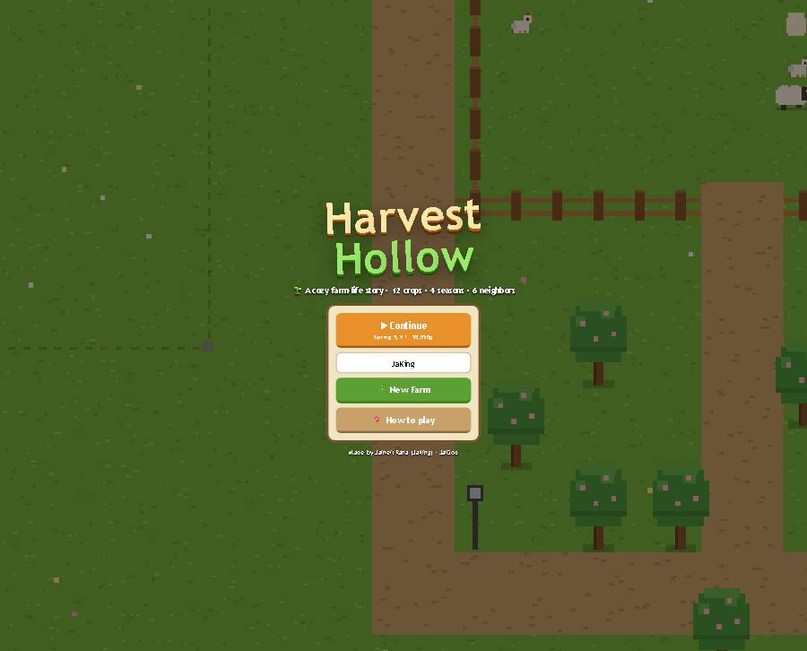
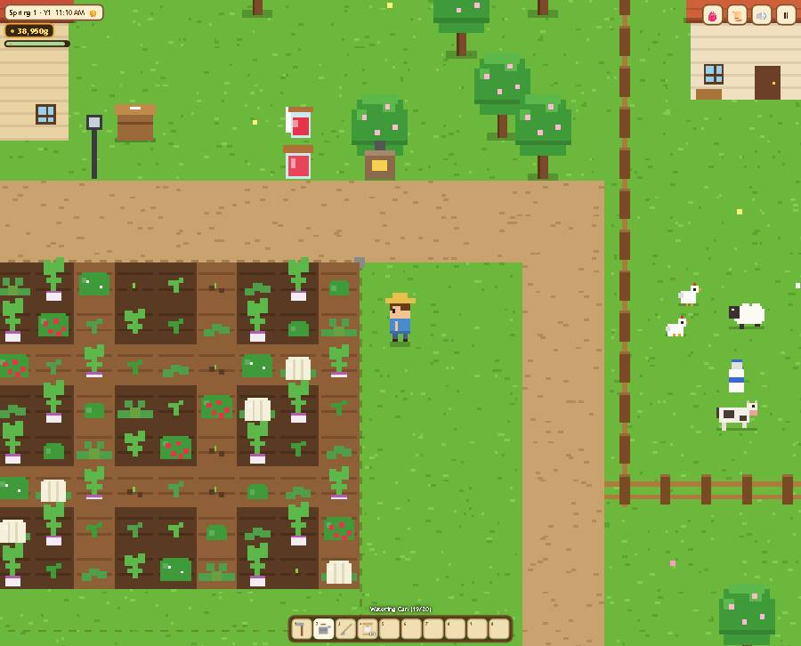
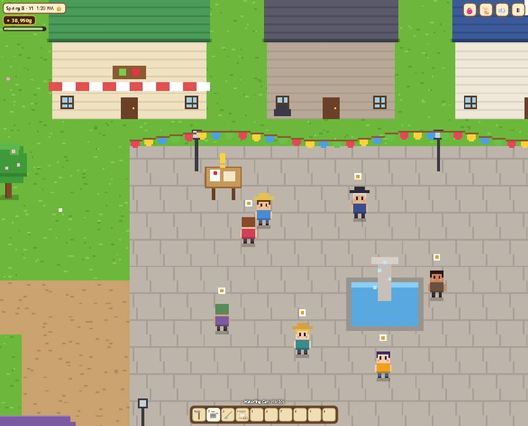
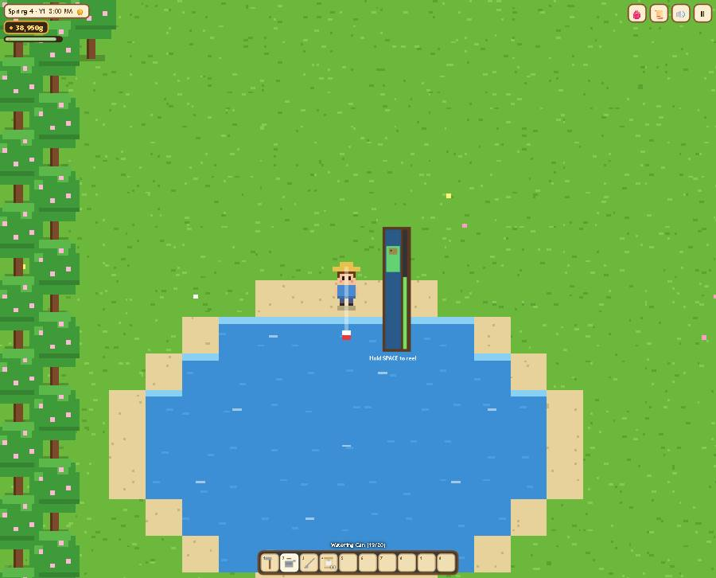
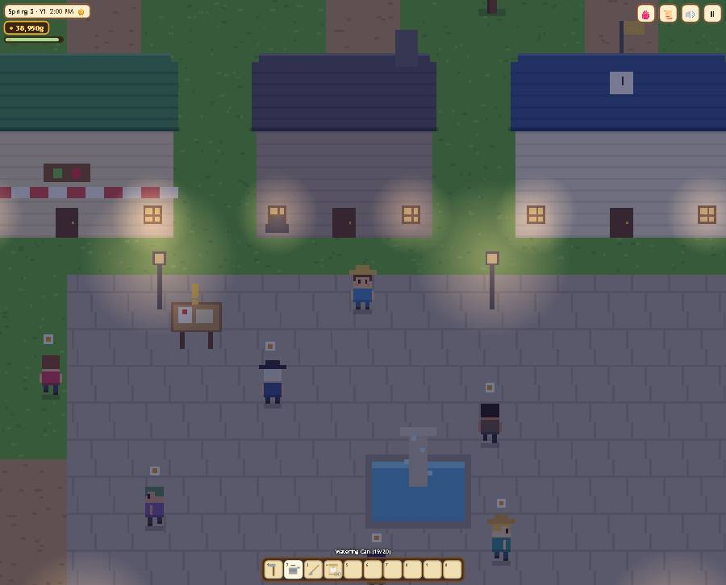
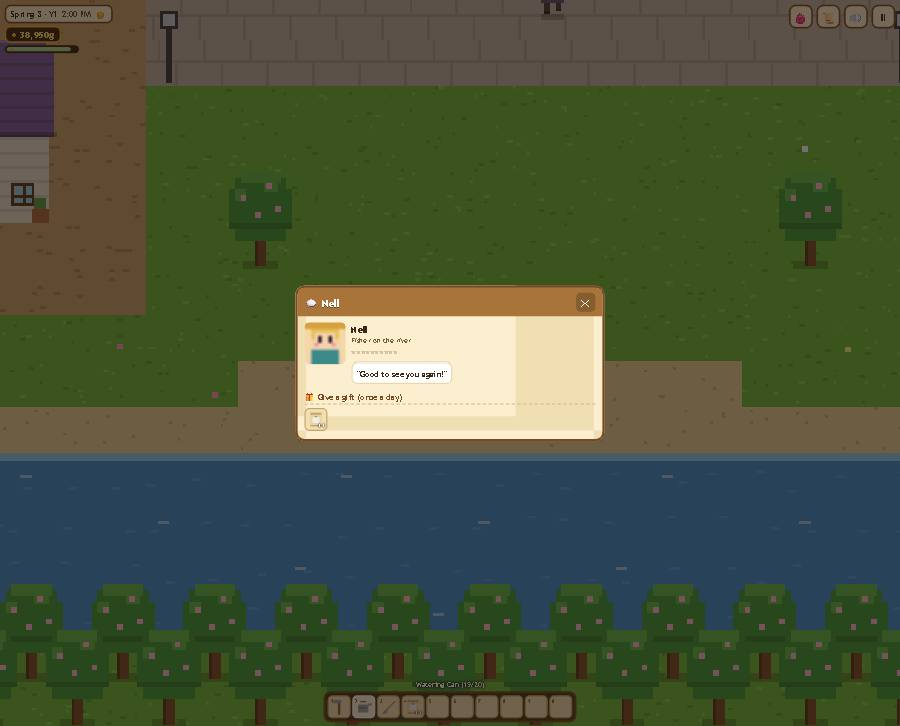
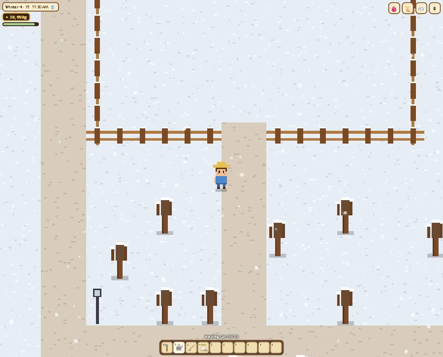
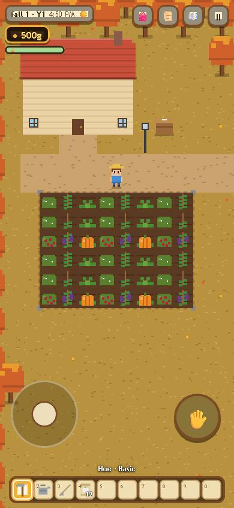

<div align="center">

# 🌾 Harvest Hollow

**A cozy pixel-art farm-life sim you can play right in your browser.**
Till the soil, raise animals, fish the river and make friends in a little village, across four seasons.

[](https://jaigod.github.io/harvest-hollow/)
[](https://github.com/JaiGod/harvest-hollow/releases/latest)




</div>

---

## 📸 Screenshots

| 🌱 Your farm | 🎉 Seasonal festival |
|:---:|:---:|
|  |  |
| **🎣 Fishing minigame** | **🌙 Night in the village** |
|  |  |
| **💬 Friendship & gifts** | **❄️ Winter on the farm** |
|  |  |

<p align="center"><br><sub>📱 Phone layout: virtual joystick + action button (fall harvest)</sub></p>

## ✨ Features

**🌱 Farming**
- Till, plant, water and harvest **12 crops** across **4 seasons**: Turnip, Strawberry, Cauliflower, Tomato, Corn, Melon, Pumpkin, Eggplant, Cranberry, Frost Leek, Snow Pea and Crystal Berry
- Every crop has its own growth stages, drawn pixel by pixel in code (roots, bushes, vines, stalks, big ground fruit)
- Regrowing crops, out-of-season crops that wither, and a watering can you refill at the pond or river
- **Weather**: sun, clouds, rain (waters your crops for you), thunderstorms with lightning, and winter snow
- **Day/night clock** from 6 AM to 2 AM with a stamina bar. Pass out and lose some gold!

**🐔 Animals & artisan goods**
- Chickens, cows and sheep that graze in the pen on fair days and eat hay when they stay inside
- Daily eggs, milk and wool, plus petting and animal friendship
- **Machines**: Cheese Press (milk → cheese), Loom (wool → cloth) and Preserves Jar (any crop → jam or pickles)

**🏘️ Village & economy**
- **Shipping bin** with an overnight payout summary
- **June's General Store**: seasonal seeds, hay, animals and machines
- **Rowan's Forge**: tool upgrades (Basic → Copper → Silver → Gold, for wider hoe/can areas and a bigger fishing bar), coop/barn construction and upgrades, and two field expansions
- **6 villagers** (Mayor Bram, June, Rowan, Nell, Pip and Sage) with daily schedules, 10-heart friendships, loved/liked/disliked gifts and dialogue that changes as you get closer
- **Fishing minigame** with 8 fish, including a legendary Golden Koi and a night-only Moonfish
- **Seasonal festivals** on day 8 (Blossom Fair, Lantern Night, Harvest Fair, Frost Festival) with bunting, double friendship and a judged contest

**🏆 Progress**
- 12-step **story quest** chain with an ending, plus a fresh **bulletin board** request every day
- **18 achievements**, a crop and fish collection log, and an autosave every night in `localStorage`

**🎵 Feel**
- A different cozy **chiptune** for each season, generated live with WebAudio, plus rain ambience and sound effects
- Sparkles on harvest, coin pops, floating text, screen shake, glowing lamps and windows at night

## 🎮 Controls

| Action | Keyboard / mouse | Touch |
|---|---|---|
| Move | WASD / arrow keys | Virtual joystick |
| Use tool / interact | Space, J or Enter, or click a nearby tile | ✋ button |
| Reel a fish | Hold Space / mouse | Hold ✋ |
| Select hotbar slot | 1–0, mouse wheel | Tap a slot |
| Backpack | E | 🎒 |
| Journal (quests, awards, friends) | Q | 📜 |
| Pause | Esc / P | ⏸ |
| Mute | M | 🔊 |

## 🧰 Tech stack

- **Vanilla JavaScript + HTML5 Canvas 2D**: no engine, no libraries, no external requests
- **All art is code**: characters, animals, crops, buildings and items are drawn with `fillRect` pixel art at a low resolution, then scaled up with crisp pixels
- **WebAudio** sequencer for the seasonal music and every sound effect
- **localStorage** saves (every access is wrapped in `try/catch`)
- **Capacitor 6 + GitHub Actions** builds the Android APK ([workflow](.github/workflows/android.yml))
- **GitHub Pages** hosts the game from the `main` branch

## 📁 Project structure

```
harvest-hollow/
├── index.html          # Page, HUD/menus CSS, touch controls and menu (panel) logic
├── game.js             # Engine: map, rendering, player, NPCs, animals, fishing, day cycle, audio, input
├── data.js             # Content and pixel art: crops, fish, items, villagers, quests, achievements, music
├── docs/screenshots/   # README images
├── .github/workflows/
│   └── android.yml     # Capacitor → HarvestHollow.apk on the v1.0.0 release
├── LICENSE
└── README.md
```

Source: [`index.html`](index.html) · [`game.js`](game.js) · [`data.js`](data.js) · [`android.yml`](.github/workflows/android.yml)

## 🚀 Run locally

```bash
git clone https://github.com/JaiGod/harvest-hollow.git
cd harvest-hollow
python3 -m http.server 8000
# open http://localhost:8000
```

Any static file server works, and so does opening `index.html` directly. There is nothing to install or build.

## 📱 Android APK

Each push to `main` runs the [Build Android APK](https://github.com/JaiGod/harvest-hollow/actions) workflow. It copies the web files into a Capacitor project, builds a debug APK with Gradle and attaches **`HarvestHollow.apk`** to the [v1.0.0 release](https://github.com/JaiGod/harvest-hollow/releases/tag/v1.0.0). App ID: `io.github.jaigod.harvesthollow`.

## 🛠️ Development log

**Design goals.** I already have a gardening game (Bloomfolk Gardens), so Harvest Hollow had to be a *whole farm life*: crops are just one system next to animals, artisan machines, a village economy, friendships, fishing and festivals. Everything had to run in one browser tab, on a phone too, with no downloads.

**Art direction.** Warm parchment-and-wood UI with a 16×16 tile world. The world is drawn into a small low-resolution canvas (for example 427×240 on a laptop), then CSS scales it up with `image-rendering: pixelated`. So every `fillRect` is a real chunky pixel. Text, the fishing meter and floating numbers go on a second, full-resolution canvas so they stay sharp. Each season repaints the ground (blossoms in spring, golden grass in fall, snow in winter), and trees change from pink blossoms to fruit, then orange leaves, then bare snowy branches.

**Making crops readable.** 12 crops × 5 stages would be 60 hand-made sprites. Instead, each crop has a *shape family* (root, bush, vine, stalk or head) plus its own colors, and one drawing routine grows that shape through the stages. Corn grows a tall stalk with cobs, pumpkins swell into ribbed orange gourds, and Crystal Berries glow cyan.

**Performance.** The static ground (grass speckles, paths, water, fences) is pre-rendered once per season into a 1024×704 offscreen canvas. Each frame only draws visible soil, crops, and a y-sorted list of trees, buildings, machines, animals and people.

**Audio.** Each season has a scale, chord progression, tempo and a seeded melody. A lookahead scheduler queues triangle bass, a soft square arpeggio and the lead into WebAudio. The lead drops out after 8 PM so nights feel quieter.

**Challenges & fixes**
- *The "frozen" camera bug:* during testing the screen sometimes stopped following the player once sheep were bought. The sheep sprite called `ctx.save()` without a matching `restore()`, so each frame added another camera translate until everything was drawn far off-screen. A save/restore audit fixed it.
- *Lost game loop:* one missing global (`isTouch`) threw inside `update()`, which skipped `requestAnimationFrame` and froze the game. Playwright's page-error log caught it right away.
- *Storm frustration:* lightning originally struck a crop 30% of the time, even if you only had one. Now it needs at least six crops and the chance is lower, so storms stay dramatic without wrecking a new farm.
- *File size:* each file has to stay under about 45 KB, so the menu UI moved into `index.html`, and the content and pixel art live in `data.js`.
- *Phones:* at 390 px wide the hotbar shrinks to 33 px slots, the HUD wraps less, and the action button changes its icon to match what you're facing (💬 🧺 🎣 💧). Verified with no horizontal scroll.

**Testing.** Automated with Playwright: plant → sleep → water → harvest → ship → get paid; save → reload → continue; shop, forge, animals, machines, fishing (catching a Bluegill), festival and night rendering; and a 390×844 touch viewport. No console errors.

**Beta tested on the live site ✅ (Nov 5, 2026).** On https://jaigod.github.io/harvest-hollow/ I started a new farm, walked around, tilled, planted and watered, let about a game-hour pass, opened the pause menu, talked to Nell, caught a fish, and checked night, the festival, winter and a 390 px phone view. No console errors, no horizontal scroll, and the canvas drew the world every time. The screenshots above were captured from that live session.

## 🔗 Links

- ▶️ **Play:** https://jaigod.github.io/harvest-hollow/
- 📦 **Releases / APK:** https://github.com/JaiGod/harvest-hollow/releases
- ⚙️ **Actions (builds):** https://github.com/JaiGod/harvest-hollow/actions
- 🏢 **JaiGod organization:** https://github.com/JaiGod
- 🎮 **More JaiGod games:** https://github.com/orgs/JaiGod/repositories

---

<p align="center">Made by Jaineil Rana (JaKing) · part of <a href="https://github.com/JaiGod">JaiGod</a></p>
